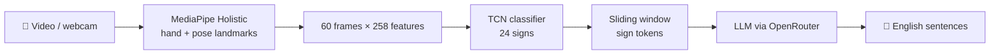
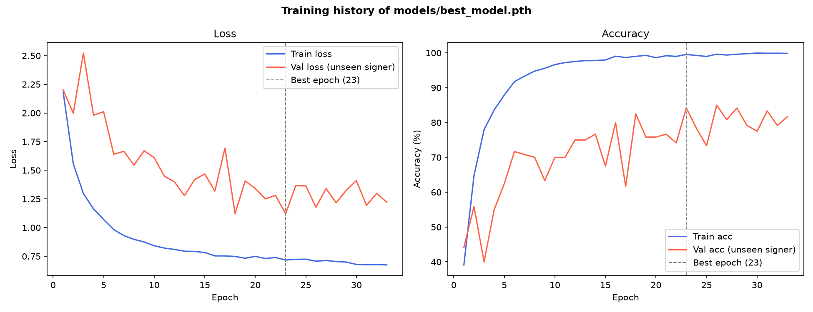

<div align="center">

# 🤟 PSL Translator

### Real-time Pakistani Sign Language recognition and translation into English

[](https://www.python.org/)
[](https://pytorch.org/)
[](https://developers.google.com/mediapipe)
[](https://flask.palletsprojects.com/)
[](https://openrouter.ai/)
[](LICENSE)

**Built by Abdul Rehman**

</div>

---

## ✨ Overview

**PSL Translator** watches a person signing in **Pakistani Sign Language** through a
webcam or a video, recognises each sign in real time, and turns the sequence of
signs into **natural English sentences** with a large language model.

<table>
<tr>
<td width="25%" align="center">🎥<br><b>Real-time</b><br>Live webcam recognition with a sliding 3-second window</td>
<td width="25%" align="center">🪶<br><b>Lightweight</b><br>~0.5 M-parameter TCN on body landmarks, runs on a CPU</td>
<td width="25%" align="center">💬<br><b>Sentences, not just words</b><br>An LLM turns sign tokens into fluent English</td>
<td width="25%" align="center">🌐<br><b>API-ready</b><br>Flask REST API: upload a video, get sentences back</td>
</tr>
</table>

## ⚙️ How it works



1. **Landmarks.** MediaPipe Holistic tracks both hands (21 points each) and the
   upper body (33 pose points) in every frame: 258 numbers per frame. Using
   landmarks instead of raw pixels makes the model small, fast and less
   sensitive to background and lighting.
2. **Classification.** A Temporal Convolutional Network reads a 60-frame window
   and predicts one of 24 signs.
3. **Continuous signing.** A 3-second window slides over the video every second,
   producing a stream of confident sign tokens.
4. **Translation.** The tokens and their confidences go to an LLM, which returns
   three candidate English sentences.

## 🖐️ Supported signs

| | | | | | |
|:-:|:-:|:-:|:-:|:-:|:-:|
| I | you | friend | teacher | student | school |
| salam | morning | thank you | please | sorry | good |
| come | go | eat | water | home | phone |
| help | learn | like | want | no | *(idle)* |

## 📊 Results

<table>
<tr>
<td>

| Metric | Value |
|---|---|
| Classes | 24 |
| Train accuracy | 99.5 % |
| **Validation accuracy** (held-out group) | **84.2 %** |
| Parameters | 497,240 |
| Input | 60 frames × 258 features |

</td>
<td width="55%">

</td>
</tr>
</table>

### Model: SignTCN

```
Input (60 × 258)
  → TCN block  258 →  64   Conv1d → BN → ReLU → Conv1d → BN  + residual
  → TCN block   64 → 128
  → TCN block  128 → 256
  → Global average pooling → Dropout 0.4 → Linear → 24 classes
```

Trained with Adam (lr 1e-3), label smoothing 0.1, learning-rate decay on
plateau and early stopping; augmented with noise, time warping, scaling,
mirroring and frame dropout.

## 🚀 Quick start

> Requires **Python 3.10–3.12** (MediaPipe does not support newer versions yet).
> The trained model is included, so no dataset is needed to run the demo.

**1. Install**

```bash
git clone https://github.com/zulfi011/psl_translation.git
```

```bash
cd psl_translation && python3.12 -m venv .venv && source .venv/bin/activate
```

```bash
pip install -e fyp
```

**2. Add your OpenRouter API key** (only needed for the sentence step)

The translation step calls an LLM through [OpenRouter](https://openrouter.ai).
**No key is included in this repository: bring your own.**

1. Create a free account at [openrouter.ai](https://openrouter.ai) and generate a key at
   [openrouter.ai/keys](https://openrouter.ai/keys).
2. Copy the example settings file and paste your key into it:

```bash
cp fyp/.env.example fyp/.env
```

```ini
# fyp/.env
OPENROUTER_API_KEY=sk-or-your-key-here
OPENROUTER_MODEL=openai/gpt-4o-mini      # any OpenRouter model ID works
```

`.env` is git-ignored, so your key never gets committed. The sign-only demo
(`step6_realtime.py`) works without a key; the sentence demo (`step7_llm.py`)
and the REST API need one.

**3. Run**

```bash
cd fyp
```

```bash
python scripts/step6_realtime.py     # live sign recognition (webcam)
```

```bash
python scripts/step7_llm.py          # live recognition + English sentences
```

Use a recorded video instead of the webcam with `PSL_VIDEO_SOURCE=path/to/video.mp4`.
Keys: `ESC` quit · `C` clear · `L` ask the LLM now.

### REST API

```bash
python server/app.py
```

```bash
curl -F "video=@my_clip.mp4" http://localhost:5000/process
```

```json
{
  "tokens": ["salam", "please", "help"],
  "sentences": ["Hello, please help me.", "...", "..."]
}
```

`GET /health` reports server status. Full details: [`fyp/README.md`](fyp/README.md).

## 📁 Repository structure

```
psl_translation/
├── fyp/                      PSL Translator v1: the complete working system
│   ├── src/psl_translator/   features, model, dataset, settings
│   ├── scripts/              step1–5 training pipeline, step6–7 real-time demos
│   ├── server/app.py         Flask REST API
│   ├── models/               trained weights, label map, training log
│   └── results/              training curves
└── research/                 research codebase for the next version
    ├── src/psl_research/     pluggable extractors, preprocessing and models
    ├── configs/              experiment configs
    └── scripts/              data, training and evaluation tools
```

## 🧭 Roadmap

- [x] Landmark-based sign recogniser (TCN) for 24 PSL signs
- [x] Real-time continuous recognition with a sliding window
- [x] LLM sentence generation and REST API
- [x] Research codebase with leave-one-signer-out evaluation
- [ ] Improved model trained with the research pipeline
- [ ] Mobile app release
- [ ] Public landmark dataset

## 📄 License

Code released under the [MIT License](LICENSE) © 2026 Abdul Rehman.

<div align="center">

**If this project is useful to you, consider giving it a ⭐**

</div>
