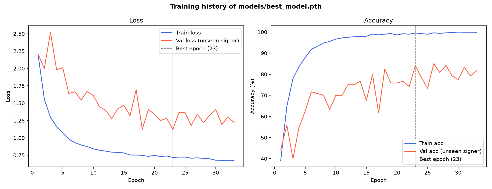

# PSL Translator v1 — Final Year Project system

> Frozen original system. New work happens in [`../research/`](../research/).

Real-time recognition of **Pakistani Sign Language (PSL)** signs from video, with
an LLM layer that turns the detected signs into natural English sentences.

Built by **Abdul Rehman**.

> The trained model is included, so you can run the real-time demo and API
> without the raw dataset.

```
video ──► MediaPipe Holistic ──► 60×258 landmarks ──► TCN classifier ──► sign tokens ──► LLM ──► English sentences
```

## How it works

1. **Landmark extraction**: MediaPipe Holistic extracts hand and body-pose
   keypoints from each frame (258 features per frame; face ignored).
2. **Sign classification**: a 3-block **Temporal Convolutional Network (TCN)**
   classifies a 60-frame window into one of **24 signs**.
3. **Sliding window**: a 3-second window, re-evaluated every second, turns a
   continuous video into a stream of sign tokens.
4. **Sentence generation**: the tokens (with confidences) go to an LLM via
   [OpenRouter](https://openrouter.ai), which returns 3 candidate English sentences.

**Supported signs:** I, come, eat, friend, go, good, help, home, learn, like,
morning, no, phone, please, salam, school, sorry, student, teacher, thankyou,
want, water, you (+ `noclass` for idle).

## Results

Split by recording group: groups 1–4 for training, group 5 (not used in
training) for validation and test. Numbers for the included `models/best_model.pth`
(from `models/training_log.json`, best epoch 23 of 33). The v2 research code
re-evaluates with verified leave-one-signer-out folds.

| Metric | Value |
|---|---|
| Train accuracy | 99.5% |
| Validation accuracy (held-out group) | **84.2%** |
| Classes | 24 |
| Model input | 60 frames × 258 features |

<p align="center">
  
</p>

## Project structure

```
.
├── src/psl_translator/      # Python package (shared code)
│   ├── config.py            #   all paths & settings (env-overridable)
│   ├── features.py          #   MediaPipe → 258-feature vectors
│   ├── model.py             #   SignTCN model
│   └── dataset.py           #   PyTorch Dataset for .npy landmark files
├── scripts/                 # Pipeline, run in order
│   ├── step1_extract_landmarks.py
│   ├── step2_split_dataset.py
│   ├── step3_augment.py
│   ├── step4_train.py
│   ├── step5_evaluate.py
│   ├── step6_realtime.py    #   webcam/video demo (signs only)
│   └── step7_llm.py         #   webcam/video demo + LLM sentences
├── server/app.py            # Flask REST API (upload video → sentences)
├── mobile/                  # Flutter app
├── models/                  # Trained weights, label map, training log
├── results/                 # Evaluation plots
├── data/                    # Dataset (not included, see data/README.md)
└── docs/                    # Documentation
```

## Setup

Requires **Python 3.10–3.12** (MediaPipe doesn't support newer versions yet).

```bash
python3.12 -m venv .venv
```

```bash
source .venv/bin/activate        # Windows: .venv\Scripts\activate
```

```bash
pip install -e fyp
```

For the LLM features, create a `.env` file with your OpenRouter key:

```bash
cp .env.example .env             # then edit OPENROUTER_API_KEY
```

## Usage

Run all commands from inside `fyp/` (the `.env` file also goes in `fyp/`).

### Real-time demo (uses the included model)

```bash
python scripts/step6_realtime.py              # signs only, webcam
```

```bash
python scripts/step7_llm.py                   # signs + LLM sentences
```

To use a recorded video instead of the webcam, set `PSL_VIDEO_SOURCE=path/to/video.mp4`.
Keys: `ESC` quit, `C` clear, `L` (step 7) force an LLM call.

### REST API

```bash
python server/app.py
```

```bash
curl -F "video=@my_clip.mp4" http://localhost:5000/process
```

Response:

```json
{
  "tokens": ["salam", "please", "help"],
  "sentences": ["Hello, please help me.", "...", "..."],
  "raw_llm": "..."
}
```

`GET /health` returns the server status. If a phone on the same network needs to
reach the API on Windows, allow the port through the firewall instead of
turning the firewall off:

```powershell
netsh advfirewall firewall add rule name="PSL API" dir=in action=allow protocol=TCP localport=5000
```

### Training from scratch

Put your videos in `data/raw/<sign>/` (see [data/README.md](data/README.md) for
the naming convention), then:

```bash
python scripts/step1_extract_landmarks.py   # videos → landmarks/*.npy
python scripts/step2_split_dataset.py       # person-aware train/val/test split
python scripts/step3_augment.py             # augment train set to 250 clips/sign
python scripts/step4_train.py               # train → models/best_model.pth
python scripts/step5_evaluate.py            # plots → results/
```

## Model

`SignTCN` stacks three residual TCN blocks (258→64→128→256 channels; each is
Conv1d → BN → ReLU → Conv1d → BN + skip), then global average pooling,
dropout (0.4), and a linear classifier. Training uses Adam (lr 1e-3), label
smoothing 0.1, ReduceLROnPlateau, and early stopping on validation loss.

Augmentation (train set only): Gaussian noise, time warping, spatial scaling,
horizontal flip, frame dropout.

## Author

**Abdul Rehman**: design, data collection, model training and implementation.

## License

[MIT](../LICENSE) © 2026 Abdul Rehman
